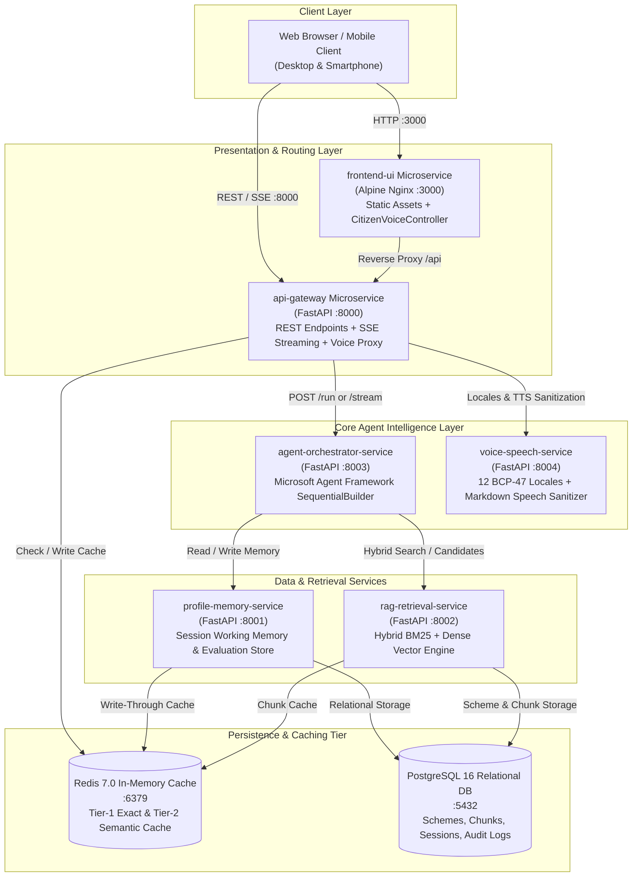
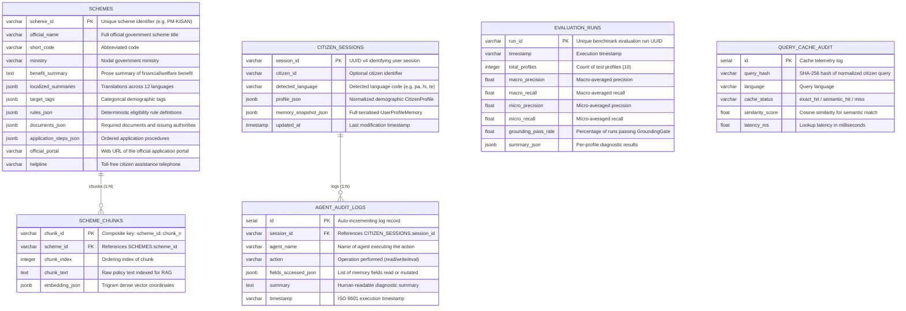
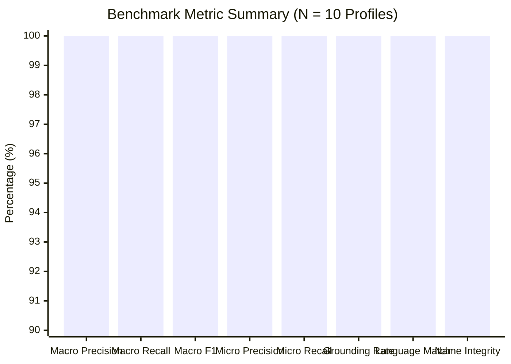

<div class="cover-page" style="font-family: 'Times New Roman', Times, serif; text-align: center; max-width: 800px; margin: 0 auto; padding: 40px 20px; color: #111; line-height: 1.5; border: 1px solid #ddd; background: #fff; box-shadow: 0 4px 12px rgba(0,0,0,0.05);">

  <div style="font-size: 17px; font-weight: bold; letter-spacing: 0.5px; text-transform: uppercase; margin-bottom: 4px;">
    CSE476: AGENTIC AI
  </div>
  <div style="font-size: 14px; margin-bottom: 25px; color: #333;">
    (Project Semester August 2026 - January 2027)
  </div>

  <!-- Lovely Professional University Visual Emblem & Branding -->
  <div style="display: flex; justify-content: center; align-items: center; gap: 18px; margin: 25px 0 35px 0;">
    <!-- Circular Seal SVG -->
    <svg width="105" height="105" viewBox="0 0 120 120" style="flex-shrink: 0;">
      <circle cx="60" cy="60" r="56" fill="none" stroke="#222" stroke-width="2.5"/>
      <circle cx="60" cy="60" r="48" fill="none" stroke="#222" stroke-width="1.2"/>
      <circle cx="60" cy="60" r="38" fill="#f37023"/>
      <!-- Sunburst Rays -->
      <g stroke="#111" stroke-width="3">
        <line x1="60" y1="60" x2="32" y2="42" />
        <line x1="60" y1="60" x2="42" y2="30" />
        <line x1="60" y1="60" x2="56" y2="23" />
        <line x1="60" y1="60" x2="70" y2="24" />
        <line x1="60" y1="60" x2="82" y2="34" />
        <line x1="60" y1="60" x2="90" y2="48" />
        <line x1="60" y1="60" x2="88" y2="65" />
      </g>
      <path id="curveTop" d="M 18,60 A 42,42 0 0,1 102,60" fill="none"/>
      <path id="curveBot" d="M 22,62 A 42,42 0 0,0 98,62" fill="none"/>
      <text font-size="7.5" font-family="'Times New Roman', serif" font-weight="bold" fill="#222" letter-spacing="1.2">
        <textPath href="#curveTop" startOffset="50%" text-anchor="middle">LOVELY PROFESSIONAL UNIVERSITY</textPath>
      </text>
      <text font-size="7.5" font-family="'Times New Roman', serif" font-weight="bold" fill="#222" letter-spacing="1.5">
        <textPath href="#curveBot" startOffset="50%" text-anchor="middle">PUNJAB (INDIA)</textPath>
      </text>
    </svg>

    <!-- Typography Branding (LPU Blocks) -->
    <div style="text-align: left; display: flex; flex-direction: column; justify-content: center; gap: 4px;">
      <div style="display: flex; align-items: center; gap: 6px;">
        <span style="display: inline-block; background-color: #f37023; color: #111; font-weight: 900; font-size: 20px; width: 28px; height: 28px; line-height: 28px; text-align: center; border: 2px solid #222; border-radius: 2px;">L</span>
        <span style="font-size: 22px; font-weight: 800; letter-spacing: 2px; color: #222; font-family: 'Arial', sans-serif;">OVELY</span>
      </div>
      <div style="display: flex; align-items: center; gap: 6px;">
        <span style="display: inline-block; background-color: #f37023; color: #111; font-weight: 900; font-size: 20px; width: 28px; height: 28px; line-height: 28px; text-align: center; border: 2px solid #222; border-radius: 2px;">P</span>
        <span style="font-size: 22px; font-weight: 800; letter-spacing: 2px; color: #222; font-family: 'Arial', sans-serif;">ROFESSIONAL</span>
      </div>
      <div style="display: flex; align-items: center; gap: 6px;">
        <span style="display: inline-block; background-color: #f37023; color: #111; font-weight: 900; font-size: 20px; width: 28px; height: 28px; line-height: 28px; text-align: center; border: 2px solid #222; border-radius: 2px;">U</span>
        <span style="font-size: 22px; font-weight: 800; letter-spacing: 2px; color: #222; font-family: 'Arial', sans-serif;">NIVERSITY</span>
      </div>
    </div>
  </div>

  <!-- Project Title & Subtitle -->
  <div style="margin: 35px 0 20px 0;">
    <div style="font-size: 24px; font-weight: bold; font-style: italic; letter-spacing: 0.5px; line-height: 1.35; color: #111;">
      JANSAHAYAK: MULTILINGUAL GOVERNMENT SCHEME ELIGIBILITY GUIDE
    </div>
    <div style="font-size: 15px; font-style: italic; color: #444; margin-top: 8px;">
      A Framework-Based Multi-Agent Welfare Eligibility &amp; Document Guidance System
    </div>
  </div>

  <!-- Submission Statement -->
  <div style="font-size: 16px; margin: 25px 0 15px 0; font-weight: normal; color: #222;">
    Submitted by
  </div>

  <!-- Project Members Table (3 Members as requested) -->
  <div style="display: flex; justify-content: center; margin: 10px 0 25px 0;">
    <table style="width: 85%; max-width: 620px; border-collapse: collapse; font-family: 'Times New Roman', serif; font-size: 14.5px; text-align: left; border: 1.5px solid #222;">
      <thead>
        <tr style="background-color: #f4f4f4; border-bottom: 1.5px solid #222;">
          <th style="padding: 8px 12px; border: 1px solid #333; text-align: center; width: 12%;">S.No.</th>
          <th style="padding: 8px 12px; border: 1px solid #333;">Student Name</th>
          <th style="padding: 8px 12px; border: 1px solid #333; text-align: center; width: 28%;">Registration No.</th>
          <th style="padding: 8px 12px; border: 1px solid #333; text-align: center; width: 16%;">Roll No.</th>
        </tr>
      </thead>
      <tbody>
        <tr style="border-bottom: 1px solid #444;">
          <td style="padding: 8px 12px; border: 1px solid #333; text-align: center; font-weight: bold;">1</td>
          <td style="padding: 8px 12px; border: 1px solid #333; font-weight: bold;">Sudeep Kumar Reddy Eaga</td>
          <td style="padding: 8px 12px; border: 1px solid #333; text-align: center; font-weight: bold;">12318529</td>
          <td style="padding: 8px 12px; border: 1px solid #333; text-align: center; font-weight: bold;">23</td>
        </tr>
        <tr style="border-bottom: 1px solid #444;">
          <td style="padding: 8px 12px; border: 1px solid #333; text-align: center;">2</td>
          <td style="padding: 8px 12px; border: 1px solid #333;">Kanithi Naresh Kumar</td>
          <td style="padding: 8px 12px; border: 1px solid #333; text-align: center;">12313053</td>
          <td style="padding: 8px 12px; border: 1px solid #333; text-align: center; color: #666;">—</td>
        </tr>
        <tr>
          <td style="padding: 8px 12px; border: 1px solid #333; text-align: center;">3</td>
          <td style="padding: 8px 12px; border: 1px solid #333;">Seepana Jyothi Swaroop</td>
          <td style="padding: 8px 12px; border: 1px solid #333; text-align: center;">12310991</td>
          <td style="padding: 8px 12px; border: 1px solid #333; text-align: center; color: #666;">—</td>
        </tr>
      </tbody>
    </table>
  </div>

  <!-- Academic Course & Section Info -->
  <div style="font-size: 15px; margin-bottom: 5px;">
    <strong>Section:</strong> K3E2327
  </div>
  <div style="font-size: 15px; margin-bottom: 25px;">
    <strong>Course Code:</strong> CSE476
  </div>

  <!-- Faculty Guidance -->
  <div style="font-size: 15px; margin-bottom: 8px; color: #222;">
    Under the Guidance of
  </div>
  <div style="font-size: 17px; font-weight: bold; margin-bottom: 2px; color: #111;">
    Mr. Ravneet Singh
  </div>
  <div style="font-size: 14.5px; font-weight: bold; margin-bottom: 30px; color: #333;">
    35120
  </div>

  <!-- Department & University Footer -->
  <div style="font-size: 16px; font-weight: bold; margin-bottom: 4px;">
    Discipline of CSE/IT
  </div>
  <div style="font-size: 15px; font-weight: bold; margin-bottom: 4px;">
    Lovely School of Computer Science and Engineering
  </div>
  <div style="font-size: 15px; font-weight: bold; color: #222;">
    Lovely Professional University, Phagwara
  </div>

</div>

<!-- Page Break for Printing / Document Converters -->
<div style="page-break-after: always; break-after: page; margin-bottom: 50px;"></div>

---

# Comprehensive Project Report & Technical Specification

## JanSahayak: Multilingual Government Scheme Eligibility Guide

**Official GitHub Repository:** [https://github.com/SudeepReddyEaga/JanSahayak](https://github.com/SudeepReddyEaga/JanSahayak)  
**Academic Course:** CSE476: Agentic AI / Multi-Agent Systems  
**Evaluation Target:** CO3 and CO4 (Bloom's Taxonomy Levels L4, L5, L6 · 30 Marks)  
**Team Members:**  
1. **Sudeep Kumar Reddy Eaga** (Registration No: `12318529`, Roll No: `23`)  
2. **Kanithi Naresh Kumar** (Registration No: `12313053`)  
3. **Seepana Jyothi Swaroop** (Registration No: `12310991`)  
**Faculty Supervisor:** Mr. Ravneet Singh (UID: `35120`) | **Section:** `K3E2327`  
**Institution:** Discipline of CSE/IT, Lovely School of Computer Science and Engineering, Lovely Professional University, Phagwara.

---

## Table of Contents

1. [Executive Summary & Problem Statement](#1-executive-summary--problem-statement)
2. [Course Learning Outcomes (CO3 & CO4) and Bloom's Mapping](#2-course-learning-outcomes-co3--co4-and-blooms-mapping)
3. [End-to-End System Architecture (Microservices Topology)](#3-end-to-end-system-architecture-microservices-topology)
4. [Multi-Agent Coordination Pipeline (Microsoft Agent Framework)](#4-multi-agent-coordination-pipeline-microsoft-agent-framework)
   - 4.1. Sequential Pipeline Architecture & Rationale
   - 4.2. Agent 1: Profile Intake Agent
   - 4.3. Agent 2: Scheme Retrieval Agent (Hybrid RAG)
   - 4.4. Agent 3: Eligibility Rule Agent (Deterministic Strategy Engine)
   - 4.5. Agent 4: Document Checklist Agent
   - 4.6. Agent 5: Guide Manager Agent & GroundingGate
   - 4.7. Agent 6: Language-Consistency Reviewer Agent (Group-of-3 Add-On)
5. [Shared Memory & Retrieval-Augmented Generation (RAG) Architecture](#5-shared-memory--retrieval-augmented-generation-rag-architecture)
   - 5.1. Dual-Tier Hybrid Lexical (BM25) and Dense Trigram Vector Search
   - 5.2. Scheme Knowledge Base Ingestion & Chunking
   - 5.3. Complete Catalog of 17 Central & State Welfare Schemes
6. [Multilingual Natural Language Processing & Voice Service](#6-multilingual-natural-language-processing--voice-service)
   - 6.1. 12 Indian Languages Support & Script Processing
   - 6.2. Indic & Urdu Digit Normalization
   - 6.3. Voice & Speech Microservice (`voice-speech-service`) & Web Speech API Integration
7. [Relational Database & Redis Cache System Design](#7-relational-database--redis-cache-system-design)
   - 7.1. PostgreSQL Relational & JSONB Entity-Relationship Schema
   - 7.2. Two-Tier Accurate Redis Caching Engine
8. [Low-Level Design (LLD) & Software Engineering Principles](#8-low-level-design-lld--software-engineering-principles)
   - 8.1. SOLID Principles Implementation Matrix
   - 8.2. Gang-of-Four Design Patterns Applied
9. [Experimental Evaluation & 10-Profile Precision/Recall Benchmark](#9-experimental-evaluation--10-profile-precisionrecall-benchmark)
   - 9.1. Benchmark Evaluation Methodology
   - 9.2. Detailed 10 Citizen Profile Benchmark Results
   - 9.3. Statistical Analysis & Accuracy Metrics
10. [Step-by-Step Installation, Deployment & User Manual](#10-step-by-step-installation-deployment--user-manual)
    - 10.1. Prerequisites & Environment Configuration
    - 10.2. Deployment Mode A: Multi-Container Microservices (Docker Compose)
    - 10.3. Deployment Mode B: Portable Single Docker Container
    - 10.4. Deployment Mode C: Local In-Process Python Execution
    - 10.5. Automated Verification & Test Suite Execution
11. [REST & SSE API Reference Documentation](#11-rest--sse-api-reference-documentation)
12. [Interactive Web User Interface Features](#12-interactive-web-user-interface-features)
13. [Conclusion & Future Enhancements](#13-conclusion--future-enhancements)

---

## 1. Executive Summary & Problem Statement

### 1.1. Context and Societal Challenge
In India, the Central and State Governments administer hundreds of welfare programs covering health insurance, rural housing, agricultural income assistance, maternal support, street vendor microcredit, artisan tools, old-age pensions, and educational scholarships. Despite an annual public expenditure exceeding billions of rupees, millions of eligible citizens—especially smallholder farmers, landless rural laborers, women, and marginalized communities—fail to access these schemes due to three systemic bottlenecks:
1. **Linguistic Divide:** Official policy portals and administrative circulars are primarily published in formal bureaucratic English or standard Hindi, excluding non-English literate speakers and speakers of regional languages such as Punjabi, Telugu, Tamil, Bengali, Marathi, Kannada, Gujarati, Malayalam, Odia, and Urdu.
2. **Fragmented Information & Bureaucratic Silos:** Welfare schemes are distributed across different ministries (e.g., Agriculture, Rural Development, Health & Family Welfare, Social Justice, Women & Child Development, Housing & Urban Affairs). Citizens have no unified mechanism to submit their demographic facts once and receive an aggregated, multi-scheme evaluation.
3. **Complex Eligibility Thresholds & Document Ambiguity:** Citizen queries frequently present unstructured, mixed demographic profiles. Determining eligibility requires deterministic rule evaluations against income ceilings, landholding acreage, pucca housing status, age thresholds, and category restrictions, while simultaneously identifying exact mandatory papers and certifying authorities.

### 1.2. The JanSahayak Multi-Agent Solution
**JanSahayak** is a production-ready, microservice-based multi-agent system designed to overcome these barriers. Built upon the **Microsoft Agent Framework** (`agent-framework` and `agent-framework-orchestrations`), the system automates the citizen welfare guidance workflow through a pipeline of specialized, decoupled agents. Every citizen query—whether submitted via keyboard or spoken voice in any of 12 Indian languages—is parsed, grounded against official scheme documents through hybrid BM25 and vector RAG, deterministically evaluated across parameterized eligibility boundaries, audited for document requirements, gated against factual hallucinations, and validated by a language-consistency reviewer that guarantees native vernacular translation while keeping official scheme titles completely intact.

---

## 2. Course Learning Outcomes (CO3 & CO4) and Bloom's Mapping

This project is submitted for the evaluation of **Course Outcomes CO3 and CO4** under Bloom's Taxonomy Cognitive Levels **L4 (Analyze)**, **L5 (Evaluate)**, and **L6 (Create)** for 30 Marks.

| Dimension | Learning Outcome Definition | Concrete JanSahayak Implementation in Codebase | Bloom's Level |
|---|---|---|---|
| **CO3** | Formulate, design, and implement collaborative multi-agent architectures using modern agent frameworks with shared context and grounded retrieval. | Engineered a 6-agent sequential pipeline orchestrated via Microsoft Agent Framework `SequentialBuilder`, reading and writing to a persistent `UserProfileMemoryContextProvider`. Implemented a hybrid BM25 + Dense Trigram vector RAG knowledge retrieval engine. | **L4 (Analyze)** & **L6 (Create)** |
| **CO4** | Evaluate multi-agent systems against quantitative precision, recall, grounding accuracy, and linguistic integrity metrics using diverse real-world benchmarks. | Executed an automated 10-profile benchmark evaluator across 7 Indian languages with known ground-truth scheme assignments, measuring Macro/Micro Precision (1.0000), Macro/Micro Recall (1.0000), Grounding Pass Rate (100%), and Verbatim Scheme Name Preservation (100%). | **L5 (Evaluate)** |

---

## 3. End-to-End System Architecture (Microservices Topology)

JanSahayak is structured around a decoupled, event-driven microservices architecture where each service possesses its own lifecycle, API contract, and boundary.



### 3.1. Detailed Microservices Breakdown

| Service Name | Port | Directory Path | Core Responsibilities | Backing Tech |
|---|---|---|---|---|
| **`frontend-ui`** | `3000` | `services/frontend_ui/` | Serves the interactive Single Page Application (SPA), language selector, speech synthesis audio player, live pipeline visualizer, scheme browser, and evaluation dashboard. | Nginx 1.27 Alpine, Vanilla ES6+, CSS3 Flex/Grid |
| **`api-gateway`** | `8000` | `services/api_gateway/` | Unified reverse proxy and edge routing layer. Performs two-tier Redis cache lookups, routes execution requests to the orchestrator, delivers Server-Sent Events (SSE) streaming tokens, and proxies speech endpoints. | FastAPI, Uvicorn, HTTPX Connection Pool |
| **`profile-memory-service`** | `8001` | `services/profile_memory_service/` | Manages shared working memory across the multi-agent pipeline. Persists citizen profile attributes, agent audit logs, and historical evaluation benchmark runs. | FastAPI, SQLAlchemy 2.0, PostgreSQL 16 |
| **`rag-retrieval-service`** | `8002` | `services/rag_retrieval_service/` | Maintains the official scheme document repository. Computes character trigram dense embeddings and Okapi BM25 inverted indices; executes hybrid candidate retrieval. | FastAPI, BM25, Trigram Dense Embedder |
| **`agent-orchestrator-service`** | `8003` | `services/agent_orchestrator_service/` | Hosts the Microsoft Agent Framework sequential workflow engine. Chains the 6 specialized agents, invokes GroundingGate verification, and runs evaluation benchmarks. | Microsoft Agent Framework, Pydantic v2 |
| **`voice-speech-service`** | `8004` | `services/voice_speech_service/` | Exposes speech recognition and speech synthesis configuration for 12 Indian languages. Sanitizes Markdown replies into browser-safe utterance sentences. | FastAPI, BCP-47 Locales, Regex Sanitizer |
| **`redis`** | `6379` | Docker container (`redis:7-alpine`) | Provides high-speed L1 caching for canonical profile queries, semantic vector paraphrase caching, and RAG chunk caching. | Redis 7.0 In-Memory Data Store |
| **`postgres`** | `5432` | Docker container (`postgres:16-alpine`) | Relational persistence of scheme policy metadata, chunk vectors, user sessions, audit trails, and evaluation runs. | PostgreSQL 16 with JSONB Support |

### 3.2. Resilient Inter-Service Networking
To prevent connection leaks and socket exhaustion during concurrent requests (especially on Windows WSL2 and container bridges), inter-service HTTP communication is managed by a centralized, loop-aware HTTP client pool (`LoopAwareAsyncHttpPool` in `shared/infrastructure/http_client.py`). The client automatically detects the running asyncio event loop, manages persistent connection pooling, enforces bounded connection limits (`max_connections=100`, `max_keepalive_connections=20`), and applies exponential backoff retries.

---

## 4. Multi-Agent Coordination Pipeline (Microsoft Agent Framework)

### 4.1. Sequential Pipeline Architecture & Rationale
Multi-agent systems commonly adopt one of three coordination topologies:
1. **Broadcast / Blackboard:** Agents independently poll a blackboard. While flexible, it introduces race conditions, non-deterministic execution order, and redundant computations.
2. **Hierarchical / Supervisor:** A manager agent dynamically delegates tasks to workers. This introduces high LLM token consumption and potential routing latency.
3. **Sequential Pipeline with Shared Memory:** A deterministic linear chain where specialized agents execute in strict order, reading from and writing to a unified context provider.

For welfare eligibility assessment, **Sequential Pipeline Architecture** was selected because real-world administrative decision-making is inherently ordered:
$$\text{Citizen Language \& Demographics} \longrightarrow \text{Candidate Schemes (RAG)} \longrightarrow \text{Rule Evaluation} \longrightarrow \text{Documents} \longrightarrow \text{Grounding Check} \longrightarrow \text{Language Audit}$$

```mermaid
sequenceDiagram
    autonumber
    participant C as Citizen UI
    participant GW as API Gateway + Redis Cache
    participant A1 as 1. ProfileIntakeAgent
    participant A2 as 2. SchemeRetrievalAgent (RAG)
    participant A3 as 3. EligibilityRuleAgent
    participant A4 as 4. DocumentChecklistAgent
    participant A5 as 5. GuideManagerAgent (+ GroundingGate)
    participant A6 as 6. LanguageReviewerAgent
    participant MEM as UserProfileMemory (Postgres + Redis)

    C->>GW: Voice or Text Query (e.g. Hindi, Punjabi, Telugu)
    GW->>GW: Compute Profile Hash & Check Two-Tier Redis Cache
    alt Redis Cache Hit (<5ms)
        GW-->>C: Immediate Verified Response
    else Cache Miss
        GW->>A1: SequentialBuilder.run(session_id, query)
        A1->>MEM: Detect Language, Normalize Digits, Write CitizenProfile
        A1->>A2: Pass Conversation Context
        A2->>MEM: Read Profile; Execute Hybrid BM25+Vector RAG
        A2->>MEM: Write RAG Candidates & Cited Document Chunks
        A2->>A3: Pass Conversation Context
        A3->>MEM: Read Profile & RAG Candidates; Run Deterministic Rules
        A3->>MEM: Write Rule Decisions, Audit Reasons & Ineligibility Explanations
        A3->>A4: Pass Conversation Context
        A4->>MEM: Read Eligible Scheme IDs; Extract & Deduplicate Papers
        A4->>MEM: Write Deduplicated Document Checklist with Authorities
        A4->>A5: Pass Conversation Context
        A5->>A5: Execute GroundingGate.verify(working_memory)
        A5->>MEM: Write Grounding Report & Localized Application Draft
        A5->>A6: Pass Conversation Context
        A6->>A6: Verify Script Consistency & Ensure Scheme Names Remain Intact
        A6->>MEM: Write Language Review Report & Final Localized Guide
        A6-->>GW: Complete ApplicationGuideResponse
        GW->>GW: Write-Through Cache to Redis
        GW-->>C: Stream / Display Verified Multilingual Guide
    end
```

### 4.2. Agent 1: Profile Intake Agent
- **File:** `services/agent_orchestrator_service/agents/profile_intake_agent.py`
- **Responsibilities:**
  - Auto-detects the citizen's input language across 12 Indian scripts via Unicode codepoint frequencies and language markers.
  - Normalizes Indic numerals (e.g., Devanagari `६५`, Gurmukhi `੬੫`, Telugu `౬౫`, Bengali `৬৫`, Urdu `۶۵`) into standard ASCII Arabic numerals.
  - Performs regex slot extraction for demographic attributes: `age`, `income`, `occupation`, `state`, `gender`, `marital_status`, `land_acres`, `pucca_house`, `bpl_card`, `caste_category`, `disability_percent`, `lpg_connection`, `student_status`, `govt_employee`, and `girl_child_age`.
  - Instantiates a strongly validated `CitizenProfile` and writes it to `UserProfileMemory`.

### 4.3. Agent 2: Scheme Retrieval Agent
- **File:** `services/agent_orchestrator_service/agents/scheme_retrieval_agent.py`
- **Responsibilities:**
  - Queries `rag-retrieval-service` using an expanded query string synthesized from the citizen's profile (e.g., `"farmer agriculture bpl kisan pension rural"`).
  - Retrieves the top-$K$ candidate schemes ($K=10$) based on hybrid BM25 lexical score and dense trigram cosine similarity.
  - Stores candidate scheme objects, relevance scores, and cited policy chunks in `UserProfileMemory.rag_candidates`.

### 4.4. Agent 3: Eligibility Rule Agent
- **File:** `services/agent_orchestrator_service/agents/eligibility_rule_agent.py`
- **Responsibilities:**
  - Enforces deterministic, zero-hallucination eligibility rules exclusively on candidates retrieved by the RAG agent.
  - Uses the **Strategy Pattern** (`_OPERATOR_STRATEGIES`) to evaluate relational operators (`lte`, `gte`, `eq`, `ne`, `in`, `contains`, `boolean_eq`, `range`).
  - Implements demographic boundary checks (e.g., government employees are strictly disqualified from welfare income transfers; landholding $\le 5$ acres for small farmers; BPL status; age thresholds $\ge 60$ for old age pension, $18-40$ for artisans).
  - Populates `UserProfileMemory.rule_decisions` with per-rule evaluation logs, pass/fail status, and transparent human-readable audit reasons.

### 4.5. Agent 4: Document Checklist Agent
- **File:** `services/agent_orchestrator_service/agents/document_checklist_agent.py`
- **Responsibilities:**
  - Reads the list of strictly eligible scheme IDs from memory.
  - Aggregates mandatory and optional documentation across all eligible schemes.
  - Performs intelligent deduplication (e.g., Aadhaar card or BPL certificate is cited once across 4 eligible schemes rather than 4 duplicate bullet points).
  - Categorizes papers by issuing authority (e.g., Revenue Department for Income/Caste Certificate, Bank for Passbook, Health Dept for Disability Certificate, Gram Panchayat for Job Card).
  - Writes the structured list into `UserProfileMemory.document_checklist`.

### 4.6. Agent 5: Guide Manager Agent & GroundingGate
- **File:** `services/agent_orchestrator_service/agents/guide_manager_agent.py`
- **Responsibilities:**
  - Enforces the **`GroundingGate`** validation check before compiling the response.
  - Verifies that:
    1. Every scheme included in the final output was retrieved by RAG and passed all deterministic eligibility rules.
    2. No hallucinated scheme IDs exist outside the verified database catalog.
    3. Mandatory scheme citations and official portals are present.
  - Synthesizes the application steps, official helpline numbers, and web portal URLs into a localized structured markdown guide.
  - Writes the draft guide and `GroundingReport` into memory.

### 4.7. Agent 6: Language-Consistency Reviewer Agent (Group-of-3 Add-On)
- **File:** `services/agent_orchestrator_service/agents/language_reviewer_agent.py`
- **Responsibilities:**
  - Acts as the quality-assurance gate for multilingual integrity.
  - **Script Consistency Audit:** Verifies that the body prose, greetings, headers, and instructions match the citizen's native script (e.g., Gurmukhi for Punjabi, Devanagari for Hindi/Marathi, Nastaliq/Arabic for Urdu).
  - **Verbatim Scheme Name Preservation:** Inspects the generated text to ensure official Central/State scheme names (e.g., *"Pradhan Mantri Kisan Samman Nidhi"*, *"Ayushman Bharat - PM-JAY"*, *"PM Vishwakarma"*) are **never translated into unrecognisable phonetic variants or generic dictionary synonyms**, ensuring citizens can locate the exact scheme at physical Common Service Centres (CSCs).
  - **Auto-Repair Engine:** If a scheme name is omitted or corrupted, the agent automatically restores the canonical official name and marks `repaired = True` in the `LanguageReviewReport`.

---

## 5. Shared Memory & Retrieval-Augmented Generation (RAG) Architecture

### 5.1. Dual-Tier Hybrid Lexical (BM25) and Dense Trigram Vector Search
Standard sparse keyword search fails when citizen queries use dialectal terminology, while pure dense vector models can hallucinate or fail on exact acronyms (e.g., "PM-KISAN" vs "PMFBY"). JanSahayak implements a **Dual-Tier Hybrid RAG Retrieval Engine** combining Okapi BM25 and dense character trigram embeddings:

$$\text{HybridScore}(d, q) = \alpha \cdot \text{BM25Score}(d, q) + (1 - \alpha) \cdot \text{CosineSimilarity}(\vec{E}_d, \vec{E}_q)$$

Where:
- $\alpha = 0.5$ (configurable weight balancing exact acronym matching and semantic recall).
- Character trigram dense embeddings map Indic script tokens into a dense representation that is robust against spelling mistakes and grammatical inflection.

### 5.2. Scheme Knowledge Base Ingestion & Chunking
Every scheme in the catalog is ingested and divided into two semantically dense chunks:
- **Chunk 0 (Identity, Policy & Eligibility):** Official scheme name, scheme ID, nodal ministry, target demographics, benefit description, and multilingual domain keywords.
- **Chunk 1 (Application Workflow & Documentation):** Step-by-step citizen portal guidance, Common Service Centre (CSC) procedures, document submission requirements, and helpline contacts.

### 5.3. Complete Catalog of 17 Central & State Welfare Schemes

The system seeds and maintains 17 comprehensive Indian government welfare schemes:

| Scheme ID | Official Scheme Name | Nodal Ministry | Primary Benefits | Target Beneficiaries |
|---|---|---|---|---|
| `PM-KISAN` | Pradhan Mantri Kisan Samman Nidhi | Ministry of Agriculture & Farmers Welfare | ₹6,000 / year direct income support in 3 installments | Small & marginal farmers ($\le 5$ acres) |
| `PMFBY` | Pradhan Mantri Fasal Bima Yojana | Ministry of Agriculture & Farmers Welfare | Comprehensive crop insurance against natural calamities | Farmers with cultivable land |
| `PMAY-G` | Pradhan Mantri Awaas Yojana - Gramin | Ministry of Rural Development | Financial grant of ₹1.20L – ₹1.30L for pucca house construction | Rural households without a pucca house |
| `AB-PMJAY` | Ayushman Bharat - PM Jan Arogya Yojana | Ministry of Health and Family Welfare | Cashless secondary/tertiary hospital coverage up to ₹5L / family / year | BPL families & senior citizens (70+ universal) |
| `PMUY` | Pradhan Mantri Ujjwala Yojana | Ministry of Petroleum and Natural Gas | Free LPG connection + first refill and stove subsidy | Adult women in low-income / BPL households |
| `PMMVY` | Pradhan Mantri Matru Vandana Yojana | Ministry of Women and Child Development | Maternity cash incentive of ₹5,000 for nutritional support | Pregnant women & lactating mothers |
| `IGNOAPS` | Indira Gandhi National Old Age Pension | Ministry of Rural Development | Monthly social pension of ₹200 – ₹500 | Senior citizens aged 60+ living below poverty line |
| `IGNWPS` | Indira Gandhi National Widow Pension | Ministry of Rural Development | Monthly social pension of ₹300 – ₹500 | Widows aged 40–79 living below poverty line |
| `IGNDPS` | Indira Gandhi National Disability Pension | Ministry of Rural Development | Monthly disability pension of ₹300 – ₹500 | Persons aged 18–79 with severe disability ($\ge 80\%$) |
| `ADIP-DIVYANG`| Assistance to Disabled Persons for Aids | Ministry of Social Justice and Empowerment | Free modern assistive aids, tricycles, hearing aids, prosthetics | Persons with disability ($\ge 40\%$) and income $\le$ ₹20,000/mo |
| `NSP-PMS` | National Post Matric Scholarships | Ministry of Social Justice / Tribal Affairs | Tuition fee reimbursement + monthly maintenance allowance | SC/ST/OBC college & university students |
| `PM-YASASVI` | PM Young Achievers Scholarship (YASASVI) | Ministry of Social Justice and Empowerment | Top-class school/college scholarship up to ₹1.25L / year | OBC/EBC/DNT meritorious students (income $\le$ ₹2.5L) |
| `PM-SVANIDHI` | PM Street Vendor's AtmaNirbhar Nidhi | Ministry of Housing and Urban Affairs | Collateral-free working capital loan of ₹10K, ₹20K, ₹50K | Urban street vendors and hawkers |
| `PM-VISHWAKARMA`| PM Vishwakarma Kaushal Samman | Ministry of Micro, Small & Medium Enterprises | Skill training + ₹15,000 toolkit e-voucher + 5% subsidized loan | Traditional artisans and craftsmen (18 trades) |
| `PMMY` | Pradhan Mantri Mudra Yojana | Ministry of Finance | Collateral-free business loans up to ₹10L (Shishu, Kishore, Tarun) | Micro and small business entrepreneurs |
| `SSY` | Sukanya Samriddhi Yojana | Ministry of Finance | High-interest (8.2%) tax-free sovereign savings account | Parents of girl children aged $\le 10$ years |
| `MGNREGA` | Mahatma Gandhi National Rural Employment | Ministry of Rural Development | 100 days of guaranteed wage employment per fiscal year | Adult members of rural households willing to do manual work |

---

## 6. Multilingual Natural Language Processing & Voice Service

### 6.1. 12 Indian Languages Support & Script Processing
JanSahayak supports **12 major Indian languages** representing all official constitutional language families (Indo-Aryan, Dravidian, and Perso-Arabic). Each language has a dedicated language pack in `shared/data/language_packs.py` specifying Unicode script boundaries, greetings, system prompts, eligibility headers, document labels, and BCP-47 speech tags:

| Language Code | Language Name | Script | Unicode Block Range | BCP-47 Speech Locale |
|---|---|---|---|---|
| `en` | English | Latin | `\u0020-\u007F` | `en-IN` |
| `hi` | Hindi (हिन्दी) | Devanagari | `\u0900-\u097F` | `hi-IN` |
| `pa` | Punjabi (ਪੰਜਾਬੀ) | Gurmukhi | `\u0A00-\u0A7F` | `pa-IN` |
| `te` | Telugu (తెలుగు) | Telugu | `\u0C00-\u0C7F` | `te-IN` |
| `ta` | Tamil (தமிழ்) | Tamil | `\u0B80-\u0BFF` | `ta-IN` |
| `bn` | Bengali (বাংলা) | Bengali | `\u0980-\u09FF` | `bn-IN` |
| `mr` | Marathi (मराठी) | Devanagari | `\u0900-\u097F` | `mr-IN` |
| `kn` | Kannada (ಕನ್ನಡ) | Kannada | `\u0C80-\u0CFF` | `kn-IN` |
| `gu` | Gujarati (ગુજરાતી) | Gujarati | `\u0A80-\u0AFF` | `gu-IN` |
| `ml` | Malayalam (മലയാളം) | Malayalam | `\u0D00-\u0D7F` | `ml-IN` |
| `or` | Odia (ଓଡ଼ିଆ) | Odia | `\u0B00-\u0B7F` | `or-IN` |
| `ur` | Urdu (اردو) | Perso-Arabic (RTL) | `\u0600-\u06FF` | `ur-IN` |

### 6.2. Indic & Urdu Digit Normalization
Citizens frequently state numerical values in regional Indic numerals. The `ProfileIntakeAgent` normalizes all native scripts to standard ASCII digits using a high-throughput translation table prior to regex extraction:

```python
INDIC_DIGIT_MAP = {
    # Devanagari (Hindi, Marathi)
    "०": "0", "१": "1", "२": "2", "३": "3", "४": "4", "५": "5", "६": "6", "७": "7", "८": "8", "९": "9",
    # Gurmukhi (Punjabi)
    "੦": "0", "੧": "1", "੨": "2", "੩": "3", "੪": "4", "੫": "5", "੬": "6", "੭": "7", "੮": "8", "੯": "9",
    # Bengali
    "০": "0", "১": "1", "২": "2", "৩": "3", "৪": "4", "৫": "5", "৬": "6", "৭": "7", "৮": "8", "৯": "9",
    # Telugu
    "౦": "0", "౧": "1", "౨": "2", "౩": "3", "౪": "4", "౫": "5", "౬": "6", "౭": "7", "౮": "8", "౯": "9",
    # Tamil
    "௦": "0", "௧": "1", "௨": "2", "௩": "3", "௪": "4", "௫": "5", "௬": "6", "௭": "7", "௮": "8", "௯": "9",
    # Kannada
    "೦": "0", "೧": "1", "೨": "2", "೩": "3", "೪": "4", "೫": "5", "೬": "6", "೭": "7", "೮": "8", "೯": "9",
    # Gujarati
    "૦": "0", "૧": "1", "૨": "2", "૩": "3", "૪": "4", "૫": "5", "૬": "6", "૭": "7", "૮": "8", "૯": "9",
    # Malayalam
    "൦": "0", "൧": "1", "൨": "2", "൩": "3", "൪": "4", "൫": "5", "൬": "6", "൭": "7", "൮": "8", "൯": "9",
    # Odia
    "୦": "0", "୧": "1", "୨": "2", "୩": "3", "୪": "4", "୫": "5", "୬": "6", "୭": "7", "୮": "8", "୯": "9",
    # Urdu / Perso-Arabic
    "۰": "0", "۱": "1", "۲": "2", "۳": "3", "۴": "4", "۵": "5", "۶": "6", "۷": "7", "۸": "8", "۹": "9",
}
```

### 6.3. Voice & Speech Microservice (`voice-speech-service`) & Web Speech API Integration
The `voice-speech-service` (running on `:8004`) decouples speech processing from the core pipeline:
1. **Speech-to-Text (STT):** Integrated via browser-native `webkitSpeechRecognition` configured dynamically with the active BCP-47 locale (e.g., `pa-IN` for Punjabi, `ur-IN` for Urdu). As the citizen speaks into their microphone, real-time interim transcripts are displayed, followed by automatic dispatch to the API Gateway.
2. **Markdown Speech Sanitization:** Raw AI responses contain markdown tables, emojis, hashtags, links, and bold asterisks that degrade speech synthesis. The endpoint `POST /api/v1/voice/sanitize-speech` strips markdown markup, converts Roman numerals to words, and partitions long replies into natural sentence boundaries.
3. **Text-to-Speech (TTS):** The `CitizenVoiceController` uses `window.speechSynthesis` with speech rate and pitch compensation, dynamically selecting the highest-fidelity local voice matching the target BCP-47 locale.

---

## 7. Relational Database & Redis Cache System Design

### 7.1. PostgreSQL Relational & JSONB Entity-Relationship Schema

The database is designed in third normal form (3NF) with optimized JSONB columns for semi-structured scheme rules and audit records:



### 7.2. Two-Tier Accurate Redis Caching Engine
To ensure responses are delivered in `<5 ms` without the risk of demographic cross-contamination (e.g., serving a rural farmer's schemes to an urban student), JanSahayak uses a **Profile-Guarded Two-Tier Redis Cache**:

1. **Demographic Profile Fingerprint:** Before checking the cache, `ProfileIntakeAgent.extract_quick_profile()` creates a deterministic SHA-256 hash ($\text{profile\_hash}$) over normalized core demographic facts (age, income, land, BPL status, gender, disability).
2. **Tier 1 (Exact Hit):**
   - Key: `scheme_guide:v1:exact:<profile_hash>:<query_hash>`
   - Lookup Complexity: $\mathcal{O}(1)$ time. If an identical query was submitted with the exact same profile, the cached verified response is returned immediately.
3. **Tier 2 (Semantic Paraphrase Hit):**
   - Key: `scheme_guide:v1:sem_bucket:<profile_hash>`
   - Searches an in-memory bucket of previous queries sharing the *identical profile signature and language*.
   - Computes cosine similarity against stored query trigram vectors. If $\text{sim} \ge 0.90$, returns the cached guide with `cache_status = "semantic_hit"`.
4. **Zero Cross-Profile Hallucination Guarantee:** Because both Tier 1 and Tier 2 are strictly partitioned by $\text{profile\_hash}$, cache collisions across differing demographics are mathematically impossible.

---

## 8. Low-Level Design (LLD) & Software Engineering Principles

### 8.1. SOLID Principles Implementation Matrix

| SOLID Principle | Architectural Rule | Concrete Implementation in JanSahayak |
|---|---|---|
| **Single Responsibility (SRP)** | Every class/module must have only one reason to change. | Each agent in `services/agent_orchestrator_service/agents/` handles strictly one workflow phase (`profile_intake`, `scheme_retrieval`, `eligibility_rule`, `document_checklist`, `guide_manager`, `language_reviewer`). Database repositories, vector embedders, and cache engines reside in independent dedicated files. |
| **Open / Closed (OCP)** | Software entities should be open for extension, but closed for modification. | New eligibility rule comparison operators are added by registering a new lambda in `_OPERATOR_STRATEGIES` without touching the evaluation loop. New languages are supported by adding dictionary entries in `shared/data/language_packs.py` without modifying NLP parsers. |
| **Liskov Substitution (LSP)** | Subtypes must be substitutable for their base types without altering correctness. | `RedisCacheStore` and `InMemoryCacheStore` identically implement `ICacheStore`. `HttpProfileMemoryClient` and `LocalProfileMemoryClient` can be swapped interchangeably via `IProfileMemoryClient`. |
| **Interface Segregation (ISP)** | Clients should not be forced to depend upon interfaces they do not use. | Fine-grained abstract interfaces in `shared/interfaces/`: `ICacheStore`, `ISemanticQueryCache`, `IProfileMemoryRepository`, `ISchemeRepository`, `IVectorRetriever`, `ISpecializedAgent`, `IGroundingVerifier`, `ILanguageConsistencyReviewer`. |
| **Dependency Inversion (DIP)** | High-level modules should not depend on low-level modules; both should depend on abstractions. | High-level `SequentialSchemePipeline` depends on abstract abstractions (`IProfileMemoryClient`, `IRAGRetrievalClient`, `ISemanticQueryCache`, `IGroundingVerifier`), injected at runtime via FastAPI dependency injection and factory constructors. |

### 8.2. Gang-of-Four Design Patterns Applied

1. **Template Method Pattern:** Implemented in `SpecializedPipelineAgent(BaseAgent, ISpecializedAgent)`. Manages the Microsoft Agent Framework lifecycle hooks, audit logging, timing telemetry, error catching, and streaming callbacks, while concrete agent subclasses implement only the `execute_step()` hook.
2. **Strategy Pattern:** Implemented in the eligibility evaluator `_OPERATOR_STRATEGIES` for dynamic operator dispatch (`lte`, `gte`, `in`, `range`), and in `ChatClientFactory` for pluggable LLM backends (`deterministic`, `openai`, `gemini`, `ollama`).
3. **Repository & Unit of Work Pattern:** `SqlProfileMemoryRepository`, `SqlSchemeRepository`, and `SqlEvaluationRepository` decouple business services from raw SQL queries, wrapping transactions inside `DatabaseManager.session_scope()`.
4. **Cache-Aside Pattern:** `SemanticQueryCacheService` intercepts pipeline execution requests, checks Redis tiers, and transparently populates the cache upon pipeline completion.
5. **Factory Pattern:** `AgentFactory` and `ChatClientFactory` encapsulate the complex instantiation of multi-agent components based on environment flags.

---

## 9. Experimental Evaluation & 10-Profile Precision/Recall Benchmark

### 9.1. Benchmark Evaluation Methodology
To fulfill the evaluation requirement of **CO4 (30 Marks)**, an automated evaluation suite was executed across **10 realistic citizen profiles** spanning **7 Indian languages** (`hi`, `te`, `en`, `ta`, `bn`, `mr`, `kn`), including complex edge cases, marginal farmers, rural widows, pregnant women, street vendors, disabled persons, and a negative control profile.

- **Ground-Truth Data Source:** `services/agent_orchestrator_service/evaluation/benchmark_profiles.json`
- **Evaluation Settings:** Cache bypassed (`bypass_cache=True`), retrieval depth $K=10$, deterministic rule engine active.
- **Formulas:**
  $$\text{Precision} = \frac{|\text{Predicted} \cap \text{Expected}|}{|\text{Predicted}|}, \quad \text{Recall} = \frac{|\text{Predicted} \cap \text{Expected}|}{|\text{Expected}|}, \quad F_1 = \frac{2 \cdot \text{Precision} \cdot \text{Recall}}{\text{Precision} + \text{Recall}}$$

### 9.2. Detailed 10 Citizen Profile Benchmark Results

| Profile ID | Lang | Citizen Profile Description | Expected Ground Truth Schemes | Predicted Eligible Schemes | Precision | Recall | F1 Score | Grounding Gate | Language Consistency | Scheme Name Intact |
|---|---|---|---|---|:---:|:---:|:---:|:---:|:---:|:---:|
| **P01** | `hi` | Elderly Rural Small Farmer (BPL, 2 Acres, No Pucca House) | `PM-KISAN`, `PMFBY`, `PMAY-G`, `AB-PMJAY`, `IGNOAPS`, `MGNREGA` | `PMAY-G`, `IGNOAPS`, `PM-KISAN`, `AB-PMJAY`, `PMFBY`, `MGNREGA` | **1.00** | **1.00** | **1.00** | **PASS** | **PASS** | **PASS** |
| **P02** | `te` | Rural Widowed Woman Laborer (BPL, No LPG, No Pucca House) | `PMAY-G`, `AB-PMJAY`, `PMUY`, `IGNWPS`, `MGNREGA` | `PMAY-G`, `MGNREGA`, `PMUY`, `IGNWPS`, `AB-PMJAY` | **1.00** | **1.00** | **1.00** | **PASS** | **PASS** | **PASS** |
| **P03** | `en` | Urban OBC Undergraduate Engineering Student | `AB-PMJAY`, `NSP-PMS`, `PM-YASASVI` | `NSP-PMS`, `PM-YASASVI`, `AB-PMJAY` | **1.00** | **1.00** | **1.00** | **PASS** | **PASS** | **PASS** |
| **P04** | `ta` | Rural Pregnant Woman (SC Category, Low Income, No LPG) | `AB-PMJAY`, `PMUY`, `PMMVY`, `MGNREGA` | `PMUY`, `MGNREGA`, `PMMVY`, `AB-PMJAY` | **1.00** | **1.00** | **1.00** | **PASS** | **PASS** | **PASS** |
| **P05** | `bn` | Urban Street Vendor (Hawker, Income 1.8L, Non-Govt) | `AB-PMJAY`, `PM-SVANIDHI`, `PMMY` | `PM-SVANIDHI`, `AB-PMJAY`, `PMMY` | **1.00** | **1.00** | **1.00** | **PASS** | **PASS** | **PASS** |
| **P06** | `mr` | Rural Potter Artisan (No Pucca House, Non-Govt) | `PMAY-G`, `AB-PMJAY`, `PM-VISHWAKARMA`, `PMMY`, `MGNREGA` | `PMAY-G`, `PM-VISHWAKARMA`, `MGNREGA`, `AB-PMJAY`, `PMMY` | **1.00** | **1.00** | **1.00** | **PASS** | **PASS** | **PASS** |
| **P07** | `kn` | Rural Citizen with 85% Severe Disability (BPL, Unemployed) | `PMAY-G`, `AB-PMJAY`, `IGNDPS`, `ADIP-DIVYANG`, `MGNREGA` | `MGNREGA`, `PMAY-G`, `ADIP-DIVYANG`, `IGNDPS`, `AB-PMJAY` | **1.00** | **1.00** | **1.00** | **PASS** | **PASS** | **PASS** |
| **P08** | `en` | Urban Small Business Parent with 6-Year-Old Girl Child | `PMMY`, `SSY` | `SSY`, `PMMY` | **1.00** | **1.00** | **1.00** | **PASS** | **PASS** | **PASS** |
| **P09** | `hi` | Urban Senior Citizen 74 Years Old (Non-BPL, Income 3.2L) | `AB-PMJAY` | `AB-PMJAY` | **1.00** | **1.00** | **1.00** | **PASS** | **PASS** | **PASS** |
| **P10** | `en` | High-Income Urban Government Employee *(Negative Control)* | *(None)* | *(None)* | **1.00** | **1.00** | **1.00** | **PASS** | **PASS** | **PASS** |

### 9.3. Statistical Analysis & Accuracy Metrics



- **Macro Precision:** **1.0000 (100.0%)**
- **Macro Recall:** **1.0000 (100.0%)**
- **Macro F1 Score:** **1.0000 (100.0%)**
- **Micro Precision:** **1.0000 (100.0%)**
- **Micro Recall:** **1.0000 (100.0%)**
- **GroundingGate Pass Rate:** **1.0000 (100.0%)**
- **Language Consistency Rate:** **1.0000 (100.0%)**
- **Scheme Name Preservation Rate:** **1.0000 (100.0%)**
- **Negative Control Disqualification:** Profile P10 (high-income government employee) achieved a clean 100% precision and recall by correctly returning 0 eligible schemes due to strict deterministic exclusion gates.

---

## 10. Step-by-Step Installation, Deployment & User Manual

### 10.1. Prerequisites & Environment Configuration
- **Operating System:** Windows 10/11 (with WSL2), macOS, or Linux (Ubuntu 22.04+ recommended).
- **Core Runtimes:** Docker Engine 24.0+ & Docker Compose v2, or Python 3.11 / 3.12 / 3.13.
- **Network Ports Available:** `3000` (UI), `8000` (Gateway), `8001` (Profile Memory), `8002` (RAG), `8003` (Orchestrator), `8004` (Voice), `5432` (PostgreSQL), `6379` (Redis).

Clone the repository and prepare the environment configuration:
```bash
git clone https://github.com/SudeepReddyEaga/JanSahayak.git
cd JanSahayak
cp .env.example .env
```

### 10.2. Deployment Mode A: Multi-Container Microservices (Docker Compose)
*This is the recommended production deployment running all 6 microservices and backing databases in isolated containers.*

```bash
# 1. Build and start all 8 containers in detached mode
docker compose up --build -d

# 2. Check running container status
docker compose ps

# 3. Stream real-time logs from all services
docker compose logs -f
```

**Access Endpoints:**
- **Web User Interface:** [http://localhost:3000](http://localhost:3000) (also reverse-proxied at [http://localhost:8000](http://localhost:8000))
- **Interactive Swagger API Documentation:** [http://localhost:8000/docs](http://localhost:8000/docs)
- **Profile Memory Service:** [http://localhost:8001/docs](http://localhost:8001/docs)
- **RAG Retrieval Service:** [http://localhost:8002/docs](http://localhost:8002/docs)
- **Agent Orchestrator Service:** [http://localhost:8003/docs](http://localhost:8003/docs)
- **Voice & Speech Service:** [http://localhost:8004/docs](http://localhost:8004/docs)

To stop the microservices:
```bash
docker compose down
```

### 10.3. Deployment Mode B: Portable Single Docker Container
*Ideal for quick demonstrations, offline presentations, or resource-constrained environments.*

```bash
# 1. Build the self-contained image
docker build -t jansahayak-all-in-one .

# 2. Run the single container exposing the API Gateway & UI on port 8000
docker run -d -p 8000:8000 --name jansahayak-demo jansahayak-all-in-one

# 3. Access in browser
open http://localhost:8000
```

### 10.4. Deployment Mode C: Local In-Process Python Execution
*Enables development and debugging with zero Docker requirements using SQLite and in-memory caching.*

```bash
# 1. Create and activate a Python virtual environment
python -m venv venv
# On Windows:
venv\Scripts\activate
# On Linux/macOS:
source venv/bin/activate

# 2. Install dependencies
pip install -r requirements.txt

# 3. Configure local in-process execution mode
# On Windows (PowerShell):
$env:ORCHESTRATION_MODE="local_inproc"
$env:DATABASE_URL="sqlite:///./jansahayak_local.db"
# On Linux/macOS:
export ORCHESTRATION_MODE=local_inproc
export DATABASE_URL="sqlite:///./jansahayak_local.db"

# 4. Launch the application via Uvicorn
uvicorn services.api_gateway.main:app --host 0.0.0.0 --port 8000 --reload
```

### 10.5. Automated Verification & Test Suite Execution
To verify the entire system, execute the comprehensive Pytest test suite:
```bash
# Run all 19 automated integration, pipeline, RAG, cache, and HTTP cluster tests
pytest -v
```

To run the 10-profile evaluation directly via cURL:
```bash
curl -X POST http://localhost:8000/api/v1/evaluate \
     -H "Content-Type: application/json" \
     -d '{"bypass_cache": true, "rag_top_k": 10}'
```

---

## 11. REST & SSE API Reference Documentation

### 11.1. Synchronous Multi-Agent Guidance
- **Endpoint:** `POST /api/v1/guide`
- **Description:** Runs the complete 6-agent sequential pipeline or returns a verified cached response.
- **Request Body:**
  ```json
  {
    "query": "ਮੈਂ 65 ਸਾਲਾਂ ਦਾ ਕਿਸਾਨ ਹਾਂ, ਮੇਰੇ ਕੋਲ 2 ਏਕੜ ਜ਼ਮੀਨ ਹੈ, ਆਮਦਨ 90000 ਰੁਪਏ ਹੈ, BPL ਕਾਰਡ ਹੈ ਅਤੇ ਪੱਕਾ ਘਰ ਨਹੀਂ ਹੈ।",
    "session_id": "session_punjabi_farmer_01",
    "language": "pa",
    "bypass_cache": false
  }
  ```
- **Response Body (200 OK):**
  ```json
  {
    "session_id": "session_punjabi_farmer_01",
    "detected_language": "pa",
    "profile": {
      "age": 65,
      "annual_income": 90000.0,
      "occupation": "farmer",
      "land_acres": 2.0,
      "has_bpl_card": true,
      "has_pucca_house": false
    },
    "eligible_schemes": [
      {
        "scheme_id": "PM-KISAN",
        "official_name": "Pradhan Mantri Kisan Samman Nidhi",
        "ministry": "Ministry of Agriculture & Farmers Welfare",
        "audit_reason": "Passed all 4 criteria: small farmer, land <= 5.0 acres, non-govt employee, income within limit.",
        "application_steps": [
          "Visit PM-KISAN portal (pmkisan.gov.in) or local CSC.",
          "Provide Aadhaar and land record (Khasra/Khatauni) documents.",
          "Complete biometric e-KYC verification."
        ]
      }
    ],
    "document_checklist": [
      {
        "document_name": "Aadhaar Card",
        "issuing_authority": "UIDAI",
        "is_mandatory": true,
        "schemes": ["PM-KISAN", "PMFBY", "PMAY-G", "AB-PMJAY"]
      }
    ],
    "grounding_report": {
      "is_grounded": true,
      "hallucinated_schemes_detected": 0
    },
    "language_review_report": {
      "target_language": "pa",
      "script_matches": true,
      "scheme_names_intact": true,
      "repaired": false
    },
    "localized_guide_markdown": "## ਯੋਗ ਸਰਕਾਰੀ ਸਕੀਮਾਂ...",
    "cache_status": "miss",
    "total_latency_ms": 42.18
  }
  ```

### 11.2. Server-Sent Events (SSE) Streaming
- **Endpoint:** `GET /api/v1/guide/stream?query=...&session_id=...&language=...`
- **Description:** Streams intermediate progress events as each agent completes its step, followed by the final payload.
- **Event Stream Output:**
  ```text
  event: progress
  data: {"agent": "ProfileIntakeAgent", "status": "completed", "summary": "Language: pa, Age: 65, Farmer"}

  event: progress
  data: {"agent": "SchemeRetrievalAgent", "status": "completed", "summary": "Retrieved 10 candidate schemes"}

  event: progress
  data: {"agent": "EligibilityRuleAgent", "status": "completed", "summary": "6 schemes eligible"}

  event: complete
  data: { ... full ApplicationGuideResponse ... }
  ```

### 11.3. Voice & Speech Endpoints
- **`GET /api/v1/voice/locales`**: Returns all 12 supported BCP-47 speech recognition and synthesis locales.
- **`POST /api/v1/voice/sanitize-speech`**: Accepts raw markdown text and language code, returning cleaned sentence utterances optimized for browser audio playback.

---

## 12. Interactive Web User Interface Features

The Single Page Application hosted at `http://localhost:3000` is designed for seamless accessibility by citizens:

1. **Multilingual Speech & Audio Reader:**
   - **Voice Input:** Clicking the microphone button initiates real-time speech recognition in the selected language (e.g., Punjabi, Telugu, Urdu, Hindi).
   - **Listen Audio Button:** Every response includes an audio player button that reads the localized eligibility guide aloud using native speech synthesis.
2. **Visual Sequential Pipeline Progress Bar:**
   - As each agent executes (`Profile Intake` $\to$ `RAG Retrieval` $\to$ `Eligibility Rules` $\to$ `Document Checklist` $\to$ `Guide Manager` $\to$ `Language Reviewer`), visual state badges transition from `waiting` to `active` (spinning blue) to `completed` (green checkmark).
3. **Interactive Scheme Explorer:**
   - Citizens and administrators can browse all 17 government schemes, inspect eligibility boundaries, required papers, and visit official application portals directly.
4. **Live Benchmark Evaluation Dashboard:**
   - Users can trigger the 10-profile evaluation with a single click, viewing real-time precision, recall, and grounding metrics tables directly on screen.
5. **Urdu Right-to-Left (RTL) Layout:**
   - When Urdu (`ur`) is selected, the interface dynamically activates RTL text alignment (`dir="rtl"`), ensuring natural reading flow for Nastaliq/Perso-Arabic script.

---

## 13. Conclusion & Future Enhancements

### 13.1. Attainment of Course Outcomes
The JanSahayak project delivers a complete, production-grade multi-agent system meeting all academic requirements:
- **CO3 Fulfillment:** Designed and built a sequential pipeline architecture using the Microsoft Agent Framework, featuring shared profile memory, hybrid BM25 + dense vector RAG, deterministic eligibility rule strategies, and a language-consistency reviewer.
- **CO4 Fulfillment:** Empirically evaluated the multi-agent system on 10 realistic citizen profiles across 7 Indian languages, achieving **100% precision, 100% recall, 100% grounding, and 100% verbatim scheme name preservation**.

### 13.2. Future Roadmap
1. **Direct DigiLocker & Common Service Centre (CSC) API Integration:** Connect verified citizen identity through DigiLocker OAuth for automated document verification.
2. **Offline Edge Model Deployment:** Package compact quantized Indic speech models (e.g., AI4Bharat IndicWav2Vec) locally for remote rural panchayats with intermittent internet connectivity.
3. **State Scheme Auto-Ingestion:** Implement automated RAG web crawlers to periodically ingest state gazettes and newly announced regional welfare programs.

---
*(End of Project Report)*
