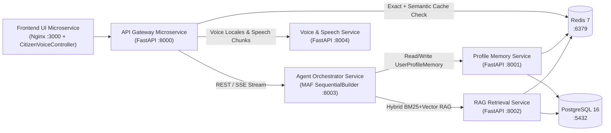
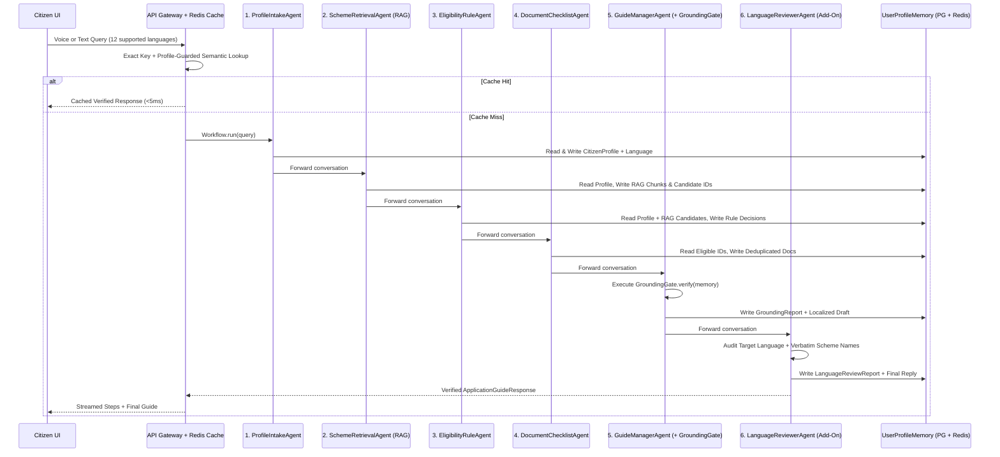
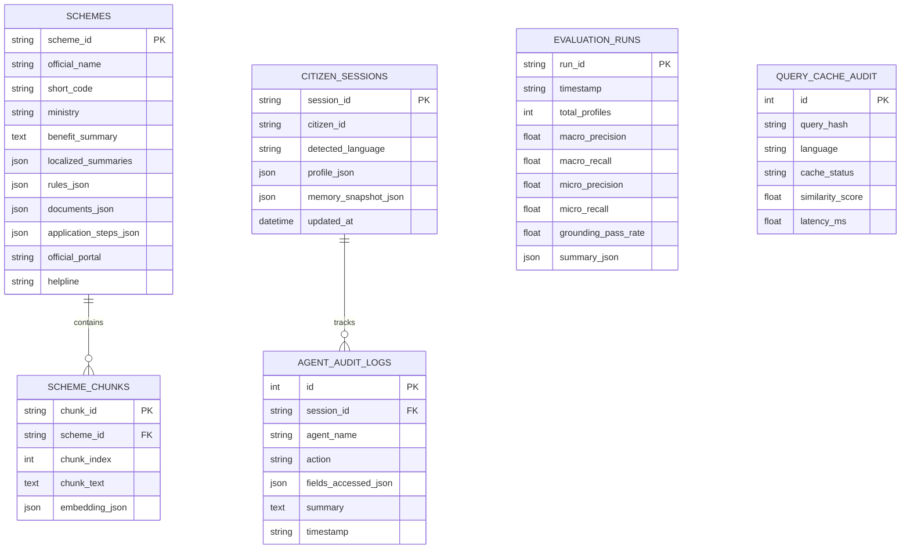

# Low-Level Design (LLD) & System Architecture

## 1. Architectural Overview (Microservices + Microsoft Agent Framework)

The **Multilingual Government Scheme Eligibility Guide** (`JanSahayak AI`) is engineered as a decoupled microservice architecture running on **Microsoft Agent Framework (`agent-framework` + `agent-framework-orchestrations`)**, **FastAPI**, **PostgreSQL**, **Redis**, and a **Voice & Speech Service** spanning **12 Indian languages**.

---

## 2. Sequential Multi-Agent Pipeline with Grounding Gate

Every citizen query travels sequentially through 6 specialized agent modules wired via `agent_framework.orchestrations.SequentialBuilder`, sharing state through `SharedProfileMemoryContextProvider(ContextProvider)`:

---

## 3. Low-Level Design (LLD) & SOLID Principles

| Principle / Pattern | Concrete Implementation in Codebase |
|---|---|
| **Single Responsibility (SRP)** | Each agent resides in its own module under `services/agent_orchestrator_service/agents/`; repositories, embedders, cache stores, and rule operators each isolate one task. |
| **Open/Closed (OCP)** | `_OPERATOR_STRATEGIES` in `eligibility_rule_agent.py` and `LANGUAGE_TEMPLATES` in `shared/data/language_packs.py` allow adding new rule operators or languages without altering core evaluators. |
| **Liskov Substitution (LSP)** | `RedisCacheStore` and `InMemoryCacheStore` identically fulfill `ICacheStore`; `HttpProfileMemoryClient` and `LocalProfileMemoryClient` fulfill `IProfileMemoryClient`. |
| **Interface Segregation (ISP)** | Focused abstract contracts in `shared/interfaces/`: `ICacheStore`, `ISemanticQueryCache`, `IProfileMemoryRepository`, `ISchemeRepository`, `IVectorRetriever`, `ISpecializedAgent`, `IGroundingVerifier`, `ILanguageConsistencyReviewer`, `IVoiceLocaleRegistry`, `ISpeechTextSanitizer`. |
| **Dependency Inversion (DIP)** | High-level `SequentialSchemePipeline` depends purely on abstract interfaces (`IProfileMemoryClient`, `IRAGRetrievalClient`, `ISemanticQueryCache`, `IGroundingVerifier`), never hardcoded database or Redis drivers. |
| **Template Method Pattern** | `SpecializedPipelineAgent(BaseAgent, ISpecializedAgent)` manages MAF lifecycle hooks, timing, read/write audit logging, and streaming while subclasses implement `execute_step()`. |
| **Strategy Pattern** | `RuleOperator` comparators (`_OPERATOR_STRATEGIES`), `HybridTextEmbedder(IEmbeddingProvider)`, and `ChatClientFactory` LLM selection (`deterministic`, `openai`, `gemini`, `ollama`). |
| **Repository & Unit-of-Work** | `SqlProfileMemoryRepository`, `SqlSchemeRepository`, `SqlEvaluationRepository` + `DatabaseManager.session_scope()`. |
| **Cache-Aside & Decorator** | `SemanticQueryCacheService` wraps pipeline execution with exact canonical lookups + profile-guarded semantic vector lookups. |

---

## 4. Relational + JSONB Database Design (PostgreSQL)

---

## 5. Redis Two-Tier Accurate Query Cache Architecture

To ensure Redis caching is **both fast and 100% accurate** (never serving another demographic's schemes):
1. **Canonical Profile Signature**: Before checking semantic similarity, `ProfileIntakeAgent.extract_quick_profile()` extracts normalized demographic facts into a SHA-256 `profile_hash`.
2. **Tier 1 (Exact Hit)**: Looks up `scheme_guide:v1:exact:<profile_hash>:<query_hash>` in $O(1)$.
3. **Tier 2 (Semantic Paraphrase Hit)**: Queries `scheme_guide:v1:sem_bucket:<profile_hash>` containing character 3-gram + token vectors of previous queries *sharing the identical language and citizen profile*. If cosine similarity $\ge \text{SEMANTIC\_CACHE\_THRESHOLD}$, returns the cached verified guide with `cache_status = "semantic_hit"`.
4. **Tier 3 (RAG & Working Memory)**: `rag-retrieval-service` caches chunk retrievals under `scheme_guide:v1:rag:*`, and `profile-memory-service` maintains write-through session memory under `scheme_guide:v1:profile_mem:*`.

